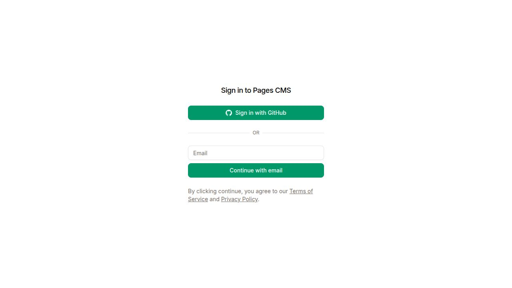
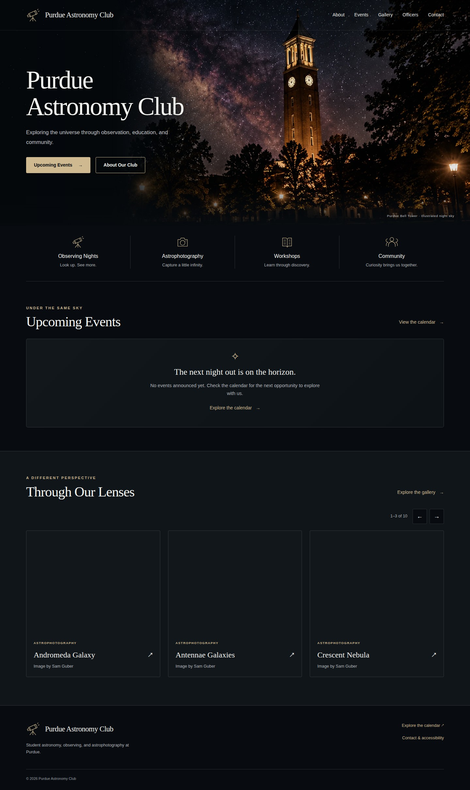

# Edit the website without code

Go to **[app.pagescms.org](https://app.pagescms.org/)** → **Sign in with GitHub** → select the club owner → **website** → **main**.

An administrator must first install the Pages CMS GitHub App for this repository and give you editor access. The owner setup is in [LAUNCH_GUIDE.md](LAUNCH_GUIDE.md). This is the hosted CMS: there is no website `/admin` account or separate server to maintain.

This screenshot shows the signed-out state available during implementation. Authenticated editor screenshots and real account publishing tests remain an owner setup task; they are not simulated here.

## What happens when you save

A CMS Save creates a GitHub commit. GitHub Actions validates the content, builds the website, and publishes it automatically. Wait for **Build and deploy website** to finish in the repository’s **Actions** tab, then refresh the website. A failed build leaves the previous successful website online.

**Draft on means not public.** New collection entries start as drafts. Switch Draft off only when all information and permissions are confirmed. Uploads themselves are public in the GitHub repository even when an entry is a draft.

## Publish a club event

1. Choose **Events and Calendar → New**.
2. Add a clear event title and short summary. On creation, choose a unique filename if asked. For repeated event names, add an occurrence date to the filename, such as `observing-night-2026-11-12`. Keep this saved filename stable later; changing the displayed title does not change its link.
3. Choose **PAC** for a club event or **Joint** for an event with another group. Choose an activity type separately.
4. Set the date and 24-hour local time: `19:00` means 7 PM. Times use Purdue’s Indiana time zone, with daylight saving handled automatically. Do not convert to UTC yourself.
5. For a timed event, leave End date blank if it ends the same day; supply End time if known. If End time is blank the calendar invitation uses a one-hour duration. For overnight events, supply both End date and End time. For all-day events, turn All-day on; the last occupied date is inclusive.
6. Add a confirmed location, optional address/map link, optional public signup link, and full description using the rich-text editor.
7. Optionally select/upload a prepared cover image. If you select a photo, fill in **Describe cover photo (required when a photo is selected)** with a brief description of what it shows. This description is required for publication.
8. Set status to Scheduled, confirm the details, turn Draft off, and Save.
9. Check the Actions run, the public calendar, and the event detail page.

Enter an event only once. Its homepage card, month cell, month overview, event page, JSON, and calendar invitations are generated from this entry. Ordinary events do not belong in Calendar Months.

Use **Tentative** when details need visible qualification. Tentative events are not featured as confirmed upcoming events. Use **Cancelled** to preserve an event’s public link and retract its invitation. Use **Postponed** when there is no replacement date; its original date is identified as such, and its calendar invitation is cancelled until a new date is scheduled. Do not delete a cancelled event if subscribers need its cancellation notice.

For another occurrence, create a new event with a distinct filename and verify its dates. There is no recurrence-rule editor.

## Automatic celestial events

The calendar now fills in **new/full/quarter moons, Mars–Neptune oppositions, equinoxes, solstices, and published meteor-shower peak nights**. Every type has its own icon; planets have distinct icons too. These entries also appear in the agenda, source/detail pages, calendar subscriptions, and optional poster export. Club events remain officer-entered and keep their separate category.

No monthly retyping is needed. The scheduled GitHub build refreshes a rolling window: the previous year, current year, and following year by default. Lunar phases and planetary alignments are calculated with Astronomy Engine; meteor peak nights use the American Meteor Society’s dated forecasts. Approximate calculated instants are converted to Indiana time. A meteor peak night is an evening-to-morning observing window, not an exact appointment or a promise of visibility.

Use **Automatic Sky Calendar** in Pages CMS to:

- Enable or disable automatic entries, or individual categories.
- Include up to two past/future years around the current year.
- Hide an individual entry: open its public detail page, copy the **Automatic event reference**, add it to **Hide automatic entries**, and Save.

To replace an automatic entry with your own sourced description, create a published **Astronomy and Night Sky** entry and paste that reference into **Automatic event reference to replace**. A published entry for the same astronomy kind, planet, and Indiana date also avoids a duplicate. Draft entries do not replace public calculations.

The automatic entries themselves are generated and do not clutter the CMS collection. Use the controls above rather than editing generated files. The public calendar’s **About the automatic sky calendar** disclosure identifies the sources, coverage and meteor check date. If AMS is temporarily unavailable, the last successful dated forecasts remain available; no meteor dates are guessed for unpublished years. More than 30 days without a successful source check is flagged publicly. For eclipses, comets, special conjunctions, or local observing advice, add a separately verified editorial highlight.

## Curate astronomy highlights and monthly images

Use **Astronomy and Night Sky** for an independently verified astronomical event. Add its date, category, summary, trusted source URL, and verification date. Leave unverified examples as drafts. These entries get their own detail pages and appear once in the shared feed, with an Astronomy label.

Use **Calendar Months and Banner Photos** only for month presentation:

- Add a unique month such as `2026-11`.
- Select an approved astrophotography image, describe it, identify the photographer, and confirm publication permission.
- Optionally write verified sky notes and add their source URL and verification date.
- Save. There is no second schedule to type.

Months without a photo use the default telescope photo. Images without permission also fall back safely. The calendar’s month can be shared with a link such as `https://purdueastro.club/events/?month=2026-11`.

## Publish an event photo album

Prepare web copies first. The optional [photo preparation tool](https://purdueastro.club/photo-prep/) processes images in your browser, resizes them, and removes EXIF metadata from the exported copy. Review the result yourself. Original repository uploads are public; removing metadata after upload cannot undo disclosure.

1. Open **Event Photo Albums → New**.
2. Set a title, event date, short description, and optional cover image with alt text. If no cover is selected, the first album photo becomes the thumbnail.
3. Confirm permission to publish all photos.
4. Under **Photos**, add one item for each image. Select/upload the image, write a description, add a caption if useful, and identify the photographer.
5. Reorder the items as desired. Each item keeps its own caption and credit.
6. Optionally enter the related event’s saved filename without `.md`. To link back from the event, set that event’s Later photo album slug to the album filename.
7. Turn Draft off and Save. The album appears on Gallery automatically, and each of its photos joins the homepage carousel with its own credit.

On the website, select a photo for the larger view. Close with the Close photo button or Escape; keyboard focus returns to its thumbnail.

## Share astrophotography

Choose **Astrophotography Showcase → New**. Add a celestial target/title, processed JPEG/WebP/PNG, image description, photographer credit, publication permission, and optional capture date/telescope/camera/filters/exposure. Add a caption and story, turn Draft off, and Save. The image appears in the gallery and homepage carousel automatically.

Do not upload camera RAW/FITS/processing project files. Aim for images about 1,600–2,400 pixels along the long edge and a few hundred KB when possible. The site creates responsive WebP derivatives during the build. Uploads over 15 MB fail validation.

## Automatic photos from Google Drive

The ten photos already supplied in **Member_Photos** are included in the website now, each credited to Sam Guber; all rotate through the homepage carousel. They display without connecting Google credentials. The following setup is for refreshing the gallery automatically as more files arrive.

After an administrator completes [Drive gallery setup](DRIVE_GALLERY_SETUP.md), upload approved processed photos directly to [Member_Photos](https://drive.google.com/drive/folders/1ovIgPYF6oufpNY4W8Q5RCMW9IeUFvaXR) under Shared with me. Name each file **firstname_lastname_target_words.jpg**. For example, `jane_doe_andromeda_galaxy.jpg` appears as **Andromeda Galaxy**, with **Image by Jane Doe**. JPEG, PNG and WebP still images are supported, up to 200 MB and 120 megapixels per Drive original. The website automatically resizes them; put them directly in the folder rather than in subfolders. The 15 MB limit above applies to manual CMS uploads.

The website checks every six hours. To publish sooner, use **GitHub → Actions → Build and deploy website → Run workflow → main**. Renaming the same Drive file updates its displayed title/credit; moving it out of the folder removes it after a successful sync. Uploads there are intended for public display with the photographer's permission.

For a better image description, caption, spelling correction or temporary hiding, open **Pages CMS → Drive Gallery Settings → Optional photo corrections** and identify the exact filename including its extension. Generated Drive photos are managed here, rather than as separate records under Astrophotography Showcase. The full setup guide includes examples and recovery steps.

These corrections also apply to the initial included photos. To remove all Drive photos from the website, turn off both **Import photos automatically** and **Show the initial imported photos when live sync is off**. With live sync enabled, the current Drive listing replaces the initial set and removed photos stay removed.

## Homepage gallery carousel

All published gallery photos join the carousel automatically; there is no separate Featured selection for photography. It shows three photos at a time on desktop, two on tablets and one on phones, moving every five seconds. Use Previous/Next, swipe, or focus the photo row and use the arrow keys/Home/End. The scrollbar is hidden and photos keep moving while hovered or while you scroll the page. There is no pause button. Rotation holds while using the keyboard inside the carousel and resumes when focus leaves; reduced-motion preferences disable automatic rotation. Titles and photographer credits stay with each photo. Open a card for its full gallery page. To hide the whole section, turn off **Homepage Settings → Show the gallery carousel**.

## News, officers, sponsors, and page copy

- **News and Announcements:** rich text, summary, optional image/alt text, publication date, Draft. Enable Featured to include it on the homepage. A future publication date keeps the entry out of public output until a later build; a scheduled build publishes it after that date.
- **Officer Page Settings:** change the academic year and the introduction above the officer cards.
- **Club Officers:** the eight 2026–27 officers are already entered from the club’s existing People page. Open a name to edit their role, portrait/alt text, biography, order, or optional approved public email. Turn Currently serving off to remove a person from the current list; turn Draft on if their public page should also be withdrawn. Confirm personal information/photo consent first.
- **Sponsors and Partners:** add only approved relationships. Add a name, logo/alt, description, website, and order. The public acknowledgments page is `/sponsors/`.
- **Homepage Settings:** edit the introduction, headline, hero image/alt text, button labels, and gallery/news visibility.
- **Contact and Social Links:** approved public email, full HTTPS social links, footer copy. Leave unused fields blank.
- **Homepage About Text / Contact Page:** edit the homepage introduction and contact copy with the rich-text editor.

The CMS changes content within the site’s design. Layout/CSS redesigns require a developer.

## Optional monthly PNG/PDF

Choose **Generate Monthly Calendar Graphic**, enter a month in `YYYY-MM` format, and run it. Follow the linked GitHub Actions run. When it finishes, download the **monthly-calendar** artifact, unzip it, and inspect the PNG/PDF before sharing.

The export uses the same website events and sky notes. It does not create a second manual Instagram schedule. Dense months or long notes may exceed a legible poster size; the workflow then fails with an explanation. Use the website calendar or shorten editorial notes rather than posting a cropped graphic.

## Change or remove a photograph safely

Reuse images from the Media library. To replace an image, choose/upload the new file inside the affected entry, keep its alt text accurate, and Save. Before deleting a media file, update every entry that references it. Deleting a referenced file causes validation to fail, and the previous site stays live. Recover the file or replace those references to fix the build.

For long periods without content edits, an administrator should also check that the scheduled GitHub workflow is still enabled; see the annual handoff guide.

## When an edit does not appear

1. Confirm Save succeeded and that you selected the publishing branch `main`.
2. Check Draft, Currently serving, Featured, and publication date as appropriate.
3. Open **GitHub → website → Actions → Build and deploy website**. The most recent content commit should have a successful run.
4. If a step is red, open its log. Validation names the entry and the missing/invalid field. Correct it in CMS and Save again.
5. After a green deployment, refresh the public page. Calendar applications may take longer to refresh subscriptions.
6. Ask a maintainer to restore an earlier version if needed; see [RECOVERY.md](RECOVERY.md).

## Reference views

