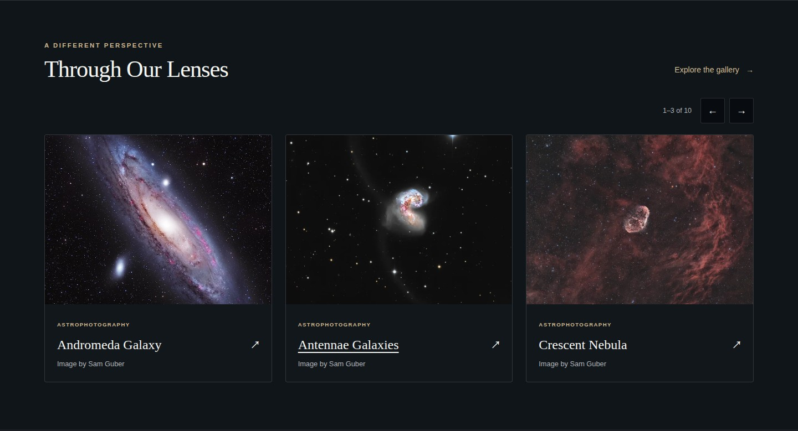
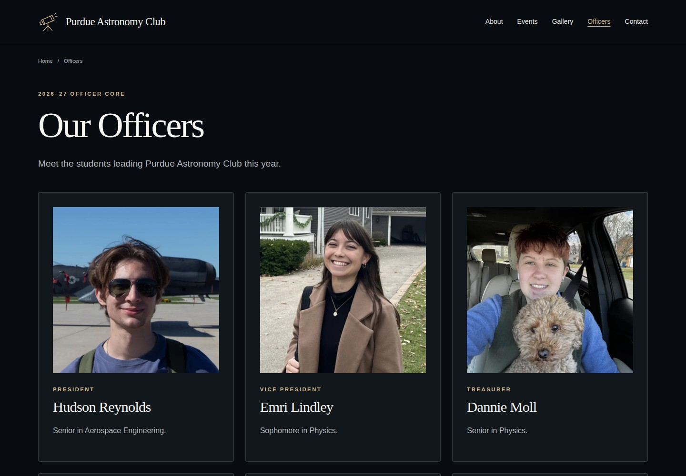
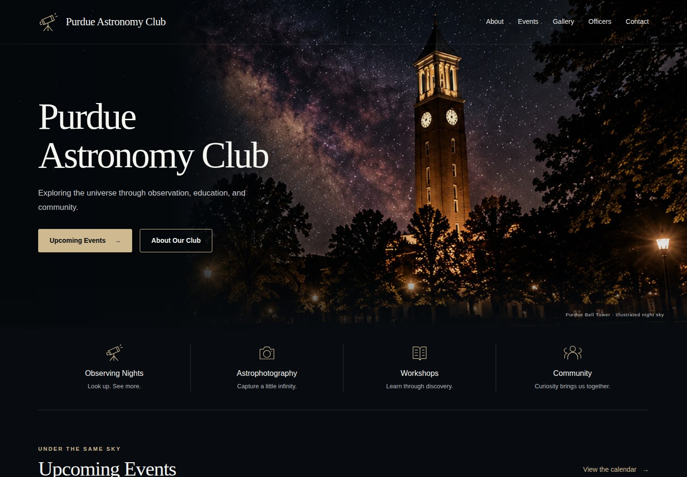
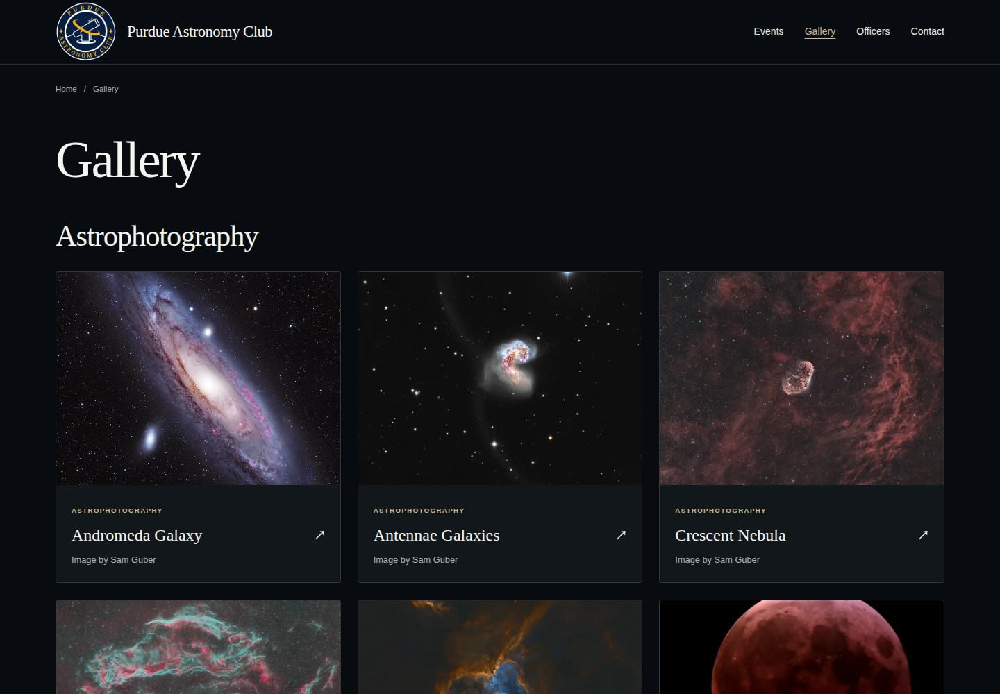
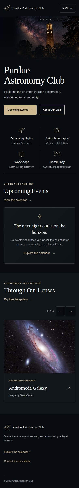
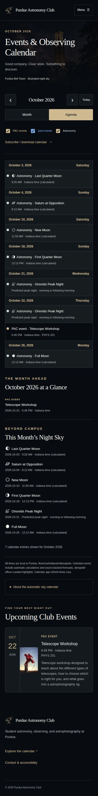
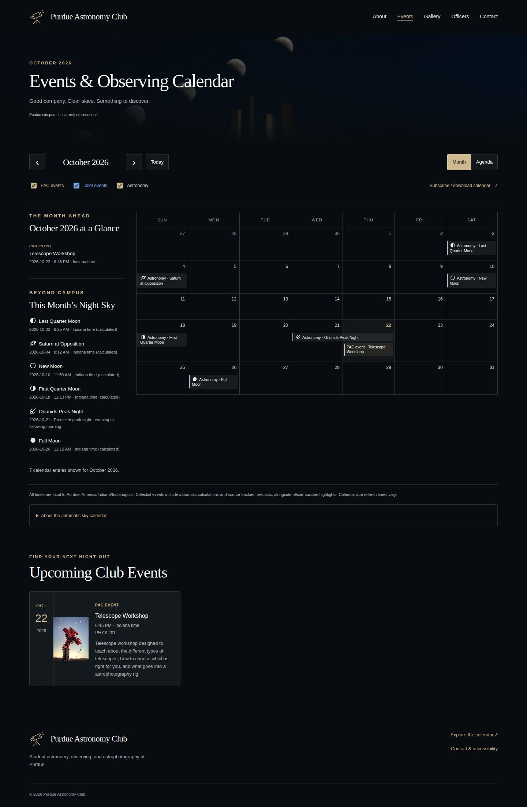

# Implementation and acceptance report

**Date:** October 22, 2026. **Production target:** https://purdueastro.club/. **Local source:** `/home/sam/website`. **Repository configured:** https://github.com/purdue-astronomy-club/website. **CMS:** https://app.pagescms.org/.

The local website implementation is complete. The owner has uploaded the initial source (`45a2e1e`), and this update corrects rendering at the repository’s `/website/` address. The correction still needs to be pushed and deployed. Authenticated CMS acceptance and production-domain setup remain owner tasks. No GitHub settings, DNS records, app permissions, or repository contents were changed remotely by the assistant. Initial account/domain observations below predate the owner’s upload.

## Phase status

| Guide phase | Verified locally | External work remaining |
|---|---|---|
| A — Structure and design | Production Hugo build, approved hero, original mark, responsive layout, screenshots | None for local implementation |
| B — CMS | All collections/settings configured; CMS-shaped records validate/build; ordered three-photo fixture album verified | Actual GitHub sign-in, app installation, non-admin officer save/upload/reuse/replace/delete tests |
| C — Calendar | Shared normalized records; filters, month/list, banners/notes, statuses, stable ICS, date/DST tests, no-JS agenda | Real calendar-app import/subscription check and CMS-to-live edit demonstration |
| D — Content pages | Albums, astrophotography, announcements, eight 2026–27 officers with portraits, sponsors, About/Contact, empty states and photo prep | Officers supply further club event, news, sponsor and approved contact content |
| E — Delivery | Actions workflows written; checksum-verified Hugo installer tested; generated link/media/draft/private-reference scan passes | Owner pushes the deployment correction, verifies domain, sets DNS/custom domain/HTTPS, verifies Actions |
| F — Handoff | Browser/accessibility/mobile tests, screenshots, officer/admin/recovery guides | Human screen-reader check and account-bound final acceptance |

## Automated checks actually run

| Check | Result |
|---|---|
| `HUGO_BIN=/tmp/pac-tools/hugo .venv/bin/python scripts/build.py` | PASS; Hugo extended 0.168.0; no template/config deprecation warnings; 229 generated Hugo pages, including 185 automatic sky records, ten real photo details and eight officer profiles |
| Generated output checks | PASS; 745 files/directories examined; no broken internal links/media or forbidden/draft references |
| `HUGO_BIN=/tmp/pac-tools/hugo .venv/bin/python -m unittest discover -s tests -v` | PASS; 66 tests including the complete isolated multi-model Hugo and Drive gallery integration tests |
| `npm run test:browser` | PASS; 55 passed, 1 intentionally skipped duplicate Firefox screenshot capture (54 behavior/accessibility checks plus one screenshot capture) |
| `bash scripts/install-hugo.sh` | PASS; official pinned release downloaded and SHA-256 verified |
| `node scripts/export-calendar.mjs 2026-10` | PASS; 1920×1080 PNG and one-page A3 landscape PDF; rendered PDF inspected |
| `node scripts/export-calendar.mjs 2026-08` | PASS; six-week month PNG and one-page A3 landscape PDF |
| Source delivery ZIP | PASS; 162 source files including ten real web photos, eight officer portraits/profiles, the homepage carousel and the deployment-path correction, hidden CMS/workflow config included, CRC checked; a fresh extraction built and retained all ten gallery/carousel entries and eight officer profiles without Drive credentials |
| Invalid poster month | PASS; rejected with an explanatory YYYY-MM validation error |
| Desktop/phone screenshot capture | PASS; 1440 px desktop and 390 px phone reference images saved |

The content/build tests cover drafts, publication, changes of month, cancelled/tentative/postponed states, stable filenames and ICS UIDs, JSON, all-day exclusive ends, overnight/year-boundary spans, leap dates, DST offsets and transitions, rejection of nonexistent/ambiguous times, escaped/folded ICS lines, image alt text/paths, unsafe links, duplicate months, permission-based banner fallback, verified sky notes, three-photo albums and responsive metadata-free derivatives with transparency preserved. The integration test publishes every content model in a temporary checkout, checks HTML/photo credits, schedules future news, moves/cancels/drafts an event, and verifies the corresponding feed/home/detail changes.

Browser checks cover 360/390/768/1024/1440/1920 px layouts without horizontal overflow, default mobile agenda, six main routes with axe WCAG A/AA rules, keyboard menu and Escape, no-JavaScript navigation/agenda, leap-February navigation, invalid month fallback, multiple events and overflow disclosure, independent category filtering, monthly image/credit/source changes, local image preparation, and photo dialog keyboard/focus behavior. Browser fixtures are intercepted locally; they do not create real public events or images.

Automated accessibility checks had no remaining reported violations on tested routes. This is not a complete manual WCAG conformance audit. The officer launch checklist explicitly retains screen-reader and real calendar-client acceptance.

## Automatic sky calendar update

The requested slogan was removed from homepage defaults, shared page headings, and the footer. Screenshots and the delivery ZIP were refreshed; the old design-reference image containing the slogan was removed from this delivery.

Automatic sky records now populate the previous, current, and following calendar years (initially 2025–2027). Astronomy Engine 2.1.19 calculates four lunar phases, Mars–Neptune oppositions, and seasonal solar events. AMS supplies dated meteor peak-night forecasts. Original SVG icons distinguish moon phases, the individual planets, meteors, and seasonal events. October 2026 shows six entries: four moon phases, Saturn’s opposition, and the Orionids peak night. No event dates were copied from the illustration.

All 50 calculated 2026 lunar phases were compared against independent USNO JSON within five minutes. Tests cover Indiana date changes across UTC midnight, the repeated DST hour, forecast-source failure/cache fallback, explicit meteor forecast years, no guessed future meteor dates, category switches, hidden events, manual replacements, deduplication, source links, SVG rendering, invitations, and out-of-range coverage messaging.

Production builds refresh AMS at most once per UTC day, preserving a dated cache through GitHub Actions. Builds now run every six hours to support Drive gallery updates. PR checks use the committed snapshot offline. Source/detail pages and the public disclosure identify calculated/forecast entries and source check dates; stale meteor snapshots are flagged after 30 days. The automatic CMS controls are in **Automatic Sky Calendar**. Existing account-bound deployment/CMS acceptance steps are still pending.

## Automatic Drive gallery update

The supplied Drive folder (`1ovIgPYF6oufpNY4W8Q5RCMW9IeUFvaXR`) was inspected through the connected Google Drive tool. A follow-up folder fetch identified it as **Member_Photos** and returned ten photos with suitable filenames. Three originals exceed 15 MB (31,076,970 / 80,864,983 / 168,060,780 bytes). Drive's importer now accepts up to 200 MB and 120 megapixels, resizes before conversion to metadata-free WebP, and keeps CMS's separate 15 MB limit unchanged. Its ID is prefilled in CMS settings. Importing remains disabled until an owner provides the dedicated service-account credential in GitHub and enables the connection. No Google sharing, service-account creation or GitHub secret changes were performed. The API key supplied in chat was not used or written into the site or delivery.

Eighteen new tests cover filename-derived target/credit, catalog identifiers and intended capitalization, metadata-free oriented images, cache reuse, stable addresses across renames, source removals, separate pages for duplicate filenames, CMS corrections/hidden photos, invalid/unsupported files, limits/download denial/corrupt images, disabled/offline modes, missing credentials, safe authentication endpoints, scoped shared-drive pagination, incomplete listing rejection, and preserving the last complete snapshot on errors. A full-size original test accepts a JPEG payload over 15 MB and reduces its 3,600-pixel width to 2,400 before the existing image pipeline. The real isolated Hugo gallery test verifies the target, photographer credit and lightbox credit, checks links/media, then removes the source photo and confirms its page/gallery entry disappear. Fixture photos never enter production content.

All 66 Python tests passed. All 55 browser checks passed with one intentional duplicate screenshot skip. The ten actual photos have now been downloaded through the authorized Drive connector, resized and stripped of embedded metadata, and included under `assets/drive-gallery-snapshot`. The original files were unchanged and were not committed. Their combined web-copy size is 3,589,290 bytes. The largest original (Cygnus Loop) is 12,262 × 8,183 pixels; all included copies are at most 2,400 pixels on the long edge. A clean build needs no Google credential and displays ten gallery cards/detail pages plus all ten images in the homepage carousel, all credited to Sam Guber. The pinned Python dependencies resolve to binary wheels for CI's Python 3.12, and the installed environment passes `pip check`. Live unattended authentication and production scheduling still require the owner's [Drive setup and acceptance steps](DRIVE_GALLERY_SETUP.md).

Four additional snapshot tests verify a fresh checkout without generated cache or credentials, CMS corrections/hidden photos, disabling the initial set and rejecting a different configured folder, and live-mode replacement/removals without resurrecting initial copies. A new browser test in Chromium and Firefox opens a real gallery card, verifies its target and credit, loads the photo on a phone-width layout, opens the larger view, checks its credit and closes it with keyboard focus restored. Desktop/mobile gallery screenshots were saved and inspected; the actual larger-photo view was also checked in the app browser.

The **Show the initial imported photos when live sync is off** setting keeps these initial photos available before the Google setup is complete. Live mode replaces that set using the same stable references. Turning both live importing and initial-photo display off withdraws Drive photography, while manual CMS entries remain independent.

## Homepage gallery carousel update

Every published astrophotograph and every image in a published event album now joins the homepage carousel. The former Featured filter and three-image cap were removed; obsolete photography Featured controls were removed from CMS. Titles, photographer credits and links to the photo/album page remain attached to each image. The carousel shows three cards on desktop, two on tablets and one on phones, advances one photo every five seconds while visible, and wraps through the entire set. It adds no dependency.

Previous/Next, native touch scrolling and keyboard arrows/Home/End are supported; the pause button was removed. The manual scrollbar is hidden and rotation continues during hover or ordinary page scrolling. Rotation holds while keyboard focus is in the carousel and resumes on exit. Reduced-motion preferences disable automatic rotation; background/out-of-view tabs do not keep rotating. All images and links remain browsable without JavaScript. Eight new browser checks across Chromium and Firefox cover matching the published gallery, wrapping, rapid navigation, responsive counts, autoplay, mouse navigation and keyboard hold/resume, continued rotation during hover/page scrolling, keyboard focus, reduced motion, reaching every photo manually and no-JavaScript scrolling. The isolated Hugo fixture also verifies that all three album photos and a separate astrophotograph appear even with legacy Featured flags off. Desktop/mobile carousel screenshots were inspected, and the app browser visibly advanced to photos beyond the first three.

## 2026–27 officer core

Eight officer profiles and all eight portraits were imported from the club’s [public People page](https://sites.google.com/view/purduepac/people), as requested, on October 22, 2026: Hudson Reynolds (President), Emri Lindley (Vice President), Dannie Moll (Treasurer), Sam Guber (Telescope Expert), Selen Serdar (Media Manager), Hana Yang (Treasurer), Purujit Gujral (Event Coordinator), and Kaayva Naidu (Secretary). Class years and majors match that page. Both Treasurer titles are preserved as published; no personal contact details or extra biographies were invented. Prior officer years and the separately listed advisor were not included in the requested officer core.

Portraits were matched to the current source page’s named cards and stored locally as metadata-free WebP files under `static/uploads/officers` (905,074 bytes combined). They display without requesting Google Sites at runtime. The list has the academic year, ordered cards and links to full portrait/role/biography pages. Pages CMS **Club Officers** edits each person; **Officer Page Settings** edits the academic year and introduction. The existing integration test now also checks the officer detail portrait, role and return link. Desktop/mobile screenshots and the live local list/profile were inspected. All 66 Python tests and 53 browser checks passed (one intentional duplicate screenshot skip).

## GitHub Pages project-path rendering correction

The uploaded site built successfully but its repository deployment showed an unstyled page. The build had used root-domain paths while the requested address was `https://purdue-astronomy-club.github.io/website/`. The deployment workflow now reads the actual Pages address with `actions/configure-pages`, supplies `HUGO_BASEURL` to the complete build, and uses the same address for the HTML and calendar feeds/invitations. Templates now resolve navigation, CMS images and responsive sources, rich-text links, icons, subscriptions, larger-photo links and redirects beneath the deployment path. Hugo-generated resource and page permalinks retain their existing prefix. The production-domain default remains available for local root-path previews.

The output validator now rejects internal URLs that escape a non-root deployment prefix, even if the target file happens to exist at the build-output root. The isolated integration test verifies a second build under `/website/`, including Markdown links, media, browser JSON, invitation URLs and the calendar redirect. A new browser regression builds a fresh isolated checkout and serves only `/website/`, returning 404 for accidental root requests. Chromium and Firefox verify loaded CSS, logo dimensions, photos, gallery larger views, officer profiles, calendar JSON/icons/details/invitations, redirects with month queries and phone layouts with no failed requests or browser errors. The regular root-path checks also pass. The final Python run passed all 66 tests; the browser suite passed all 55 checks after correcting a new test assertion to allow the calendar’s expected month query parameter (one intentional duplicate screenshot skip). The project-path homepage was also inspected in the app browser.

This correction is saved locally and must be pushed to trigger the updated production build. After changing the GitHub Pages custom domain in future, run the full build again to update all generated paths. The live replacement is not claimed as verified before that push/deployment.

## Implemented routes

| Route | Behavior |
|---|---|
| `/` | Editable hero, four activities, next three confirmed club/joint events, rotating carousel of all published gallery photos, news when available |
| `/about/`, `/contact/` | Editable rich text; approved contact/social details only |
| `/events/?month=YYYY-MM` | Month/agenda, automatic celestial events and icons, PAC/joint/astronomy filters, derived overview, verified notes, monthly banner |
| `/events/{saved-filename}/` | Event information, status and calendar invitation |
| `/astronomy/{saved-filename}/` | Source-backed astronomy details |
| `/calendar/` | Redirect to the single events calendar, retaining query when JavaScript is available |
| `/gallery/`, `/albums/`, `/astrophotography/` | Gallery hub and content archives |
| `/albums/{saved-filename}/` | Ordered images, alt text, captions, credits, accessible optional photo viewer |
| `/astrophotography/{saved-filename}/` | Image, credit, capture metadata and story |
| `/announcements/`, `/announcements/{saved-filename}/` | Date-gated news archive and articles |
| `/officers/`, `/officers/{saved-filename}/` | Current list and biography pages |
| `/sponsors/`, `/sponsors/{saved-filename}/` | Approved acknowledgments; footer link appears when populated |
| `/events.json`, `/months.json` | Generated public calendar/presentation data |
| `/calendar.ics`, `/events/{saved-filename}/event.ics`, `/astronomy/{saved-filename}/event.ics` | Subscription and per-entry invitations |
| `/calendar-poster/?month=YYYY-MM` | Shared-data poster rendering for the optional export workflow |
| `/photo-prep/` | Optional browser-only resizing and metadata-free WebP export |
| `/404.html`, `/sitemap.xml`, `/robots.txt` | Public navigation/error/search metadata |

Collection detail routes exist after the corresponding verified content is published. Drafts do not create public routes. There are no fabricated officer names, sponsors, contacts, or astronomy dates. No real calendar dates were copied out of the poster reference.

## Initial setup observations before the owner’s upload

- GitHub owner type: **User**, not Organization. Repository public and empty, no branches returned by `git ls-remote`.
- Authoritative nameservers: `curitiba.ns.porkbun.com`, `fortaleza.ns.porkbun.com`, `maceio.ns.porkbun.com`, `salvador.ns.porkbun.com`.
- Existing apex A answers: `192.0.79.151`, `192.0.79.166`.
- Existing apex AAAA query: no answers observed.
- `www` resolved to the same old hosting addresses; no CNAME answer was observed.
- HTTPS returned the old site titled **purdueastro.club — Coming Soon**. This does not verify the new site’s deployment or GitHub certificate.
- Pages CMS opened to its real GitHub sign-in screen. No authenticated CMS session or app permission was available.

Follow [LAUNCH_GUIDE.md](LAUNCH_GUIDE.md) to complete ownership, upload, GitHub Pages, verification TXT, DNS, HTTPS, CMS authorization, and the real officer publishing test. Keep the old DNS screenshot/export for rollback.

## Design references and screenshots

The design retains the dark canvas, Purdue-inspired gold, serif hierarchy, transparent desktop header, left headline/right tower, restrained line icons and cards. Content remains live HTML. The mobile hero uses a separate image above its text so the tower remains visible. The gallery now includes the ten supplied real astrophotographs, with all ten also rotating through the homepage carousel. Club event and event-album sections remain empty until officers publish confirmed content; the sky calendar contains independently calculated/source-backed celestial events.

## Practical limits and choices

- FullCalendar Standard is pinned and self-hosted at tested version 6.1.20; no premium components or runtime external event API.
- System serif/sans fonts avoid a separate font request and license dependency.
- Editor filenames are chosen once on creation and rename is disabled in CMS. Distinct occurrences need distinct filenames. Title edits retain links and invitation identity.
- For ambiguous/nonexistent local DST times, validation asks the editor to choose a different time. UTC is used in invitations after verified Indiana conversion.
- Keep cancellation records published to communicate updates to subscribers. Subscription refresh is controlled by the receiving calendar app.
- Manual CMS upload originals are public Git history. Production derivatives strip metadata; the pre-upload tool and contributor review address those originals before publication. Drive originals stay in Drive; only sanitized web copies were included in the initial source snapshot.
- Optional poster exports derive from website records. Dense layouts fail with an explanation instead of silently cropping or hiding events. The printable PDF contains the verified PNG on a single sheet; the website remains the accessible interactive source.
- Existing real CMS screenshots, actual upload saves, remote Actions, production DNS/HTTPS, and officer permissions are **not claimed as passed**. Those depend on the owner’s account actions.
